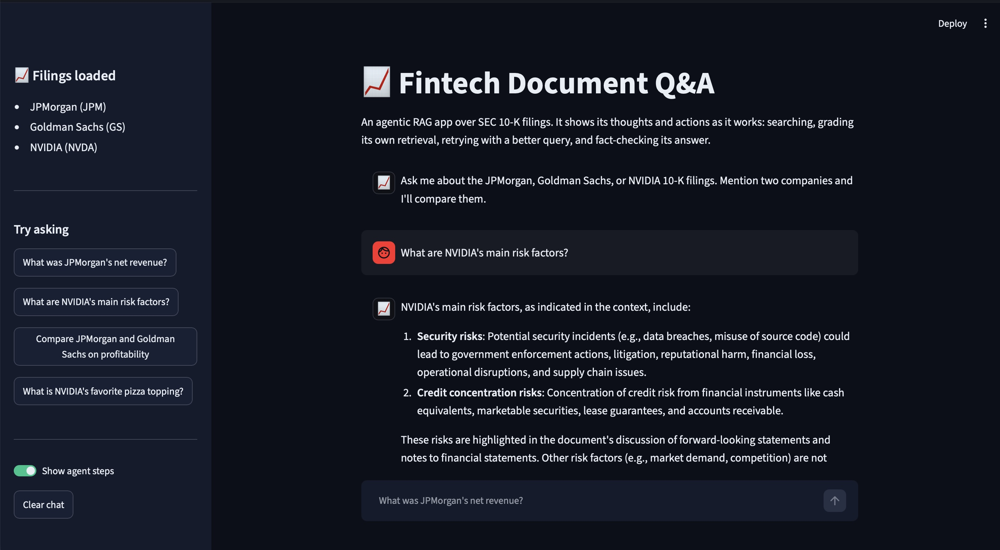

# 📈 Fintech Document Q&A (Agentic RAG)

Ask questions about real SEC 10-K filings and get answers grounded in the documents, generated by a locally run LLM. No API key, no cost, and your documents never leave your machine.

Unlike a basic RAG pipeline, this one checks its own work: it grades what it retrieved, retries with a better query when results are weak, declines to answer when there's no evidence, and fact-checks every answer against its sources.



## What the agent does

| Step | Behavior |
|---|---|
| Scope | Detects which company a question is about and searches only that company's filing. Two companies means comparison mode. |
| Grade | Asks the model whether the retrieved chunks can actually answer the question. |
| Retry | If retrieval is weak, rewrites the query and searches once more. |
| Decline | If there's still no relevant evidence, it says so instead of guessing. |
| Fact-check | Checks the generated answer against its own sources and returns a high, medium, or low confidence level. |

The Streamlit app shows these steps for every answer, along with the confidence level and the exact source pages.

Example questions:
- "What was JPMorgan's net revenue?"
- "What are NVIDIA's main risk factors?"
- "Compare JPMorgan and Goldman Sachs on profitability"

## Architecture

```
User question
      ↓
Detect companies mentioned → scope search to that filing
(2+ companies → comparison mode)
      ↓
Vector search (ChromaDB + nomic-embed-text)
      ↓
Grade retrieval: relevant?
  no → reformulate query → search again → still no → "not found"
  yes ↓
Generate answer from retrieved chunks only (qwen3:8b)
      ↓
Self-critique: is every claim supported by the sources?
→ high / medium / low confidence
      ↓
FastAPI /ask → Streamlit chat UI (answer, confidence, steps, sources)
```

## Tech Stack

**LLM / RAG:** LangChain, ChromaDB, Ollama (qwen3:8b, nomic-embed-text)
**Backend:** FastAPI
**Frontend:** Streamlit
**Documents:** PyPDF, LangChain text splitters

## Data

Real 10-K filings from [SEC EDGAR](https://www.sec.gov/edgar/search/): JPMorgan Chase, Goldman Sachs, and NVIDIA.

## Project Structure

```
fintech-rag/
├── agent.py          # Agentic pipeline: grading, retry, self-critique, comparison
├── ingest.py         # Loads PDFs, tags chunks by company, builds the vector database
├── main.py           # FastAPI backend (/ask endpoint)
├── app.py            # Streamlit chat UI
├── .streamlit/       # Finance dark theme
├── documents/        # Source 10-K PDFs
├── requirements.txt
└── chroma_db/        # Generated, not committed
```

## Running It

**1. Set up Ollama** and pull the models:
```bash
ollama pull qwen3:8b
ollama pull nomic-embed-text
```

**2. Install dependencies:**
```bash
python3 -m venv venv
source venv/bin/activate
pip install -r requirements.txt
```

**3. Add your documents** to `documents/` and set the filename-to-company mapping in the `DOCS` dictionary at the top of `ingest.py`.

**4. Build the vector database** (rebuilds from scratch and takes several minutes):
```bash
python ingest.py
```

**5. Optional quick test** of the agent from the terminal:
```bash
python agent.py
```

**6. Run the backend** (Terminal 1):
```bash
uvicorn main:app --reload
```

**7. Run the frontend** (Terminal 2, venv active):
```bash
streamlit run app.py
```

## API

`POST /ask` with `{"question": "..."}` returns:

```json
{
  "answer": "...",
  "confidence": "high",
  "retried": false,
  "search_query": "...",
  "sources": [{"company": "JPMorgan", "page": 12, "excerpt": "..."}],
  "steps": ["Search scoped to JPMorgan", "..."]
}
```

## Engineering Notes

- **Batched embedding:** embedding all chunks in one request overwhelmed the local Ollama server, so chunks are embedded in batches of 50.
- **Chunk overlap:** 200-character overlap keeps facts from being split across chunk boundaries.
- **Company-scoped retrieval:** every chunk is tagged with its company, so a question about NVIDIA never pulls text from the banks.
- **Declines instead of guessing:** with no relevant evidence after one retry, the agent says so with low confidence rather than generating an answer.
- **Self-critique:** every answer is checked against its own sources before a confidence level is shown.

## Limitations

- Each question is answered independently, so there's no conversation memory yet.
- Grading and confidence come from an 8B local model, so they are judgments, not calibrated probabilities.
- Only three filings are loaded.
- For information only, not investment advice.

## Future Improvements

- [ ] Conversation memory for follow-up questions
- [ ] Evaluate the agent against a plain RAG baseline on a fixed question set
- [ ] Live market data tool for peer comparison beyond the filings
- [ ] Dockerize and deploy

## Author

**Megha Dalsania** · [LinkedIn](https://www.linkedin.com/in/megha-dalsania-b04b90267) · [GitHub](https://github.com/Megha301278)
